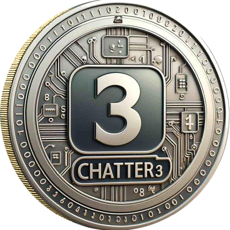
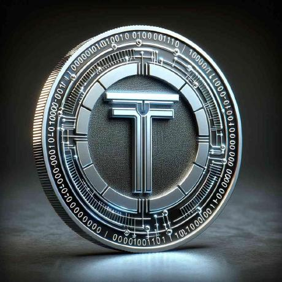

# blockchain.communication

<table>
<tr>
<td align="center" width="20%"> <b><a href="https://github.com/chatter3">chatter3</a></b> the forum</td>
<td align="center" width="20%"> <b><a href="https://github.com/chattchain">chattchain</a></b> the chain</td>
<td align="center" width="20%"> <b><a href="https://github.com/web3comm">web3comm</a></b> the environment</td>
<td align="center" width="20%"> <b><a href="https://github.com/blktalk">blktalk</a></b> the systems layer</td>
<td align="center" width="20%"> <b><a href="https://github.com/blockwhisper">blockwhisper</a></b> the continuation</td>
</tr>
</table>

The working record of `blockchain.communication` across its organizations: the forum
([chatter3](https://github.com/chatter3)), the chain ([chattchain](https://github.com/chattchain)), the
environment ([web3comm](https://github.com/web3comm)) and the systems layer
([blktalk](https://github.com/blktalk)), kept in [blockwhisper](https://github.com/blockwhisper) for continuation.

**Start with [CONTINUATION.md](CONTINUATION.md)**: what exists, what is done, what is waiting and on
whom, and the rules.

| Path | What |
|---|---|
| [CONTINUATION.md](CONTINUATION.md) | the handover |
| [orgs/](orgs) | each org's landing (`.github/profile/README.md`) |
| [BRANDING.md](BRANDING.md) | blockwhisper's official branding: the mark, files, colour, type and name |
| [logos/](logos) | the five organizations' logos: blockwhisper's own (full logo and mark, PNG + SVG), chatter3's silver-gold coin, and the others as on GitHub |
| [icon/](icon) | chatter3's icon, transparent with a silver-gold edge, and the two scripts that made it |
