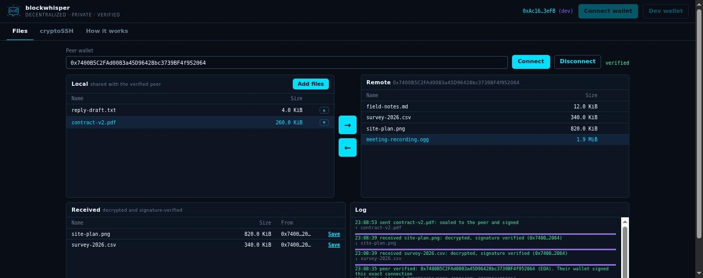
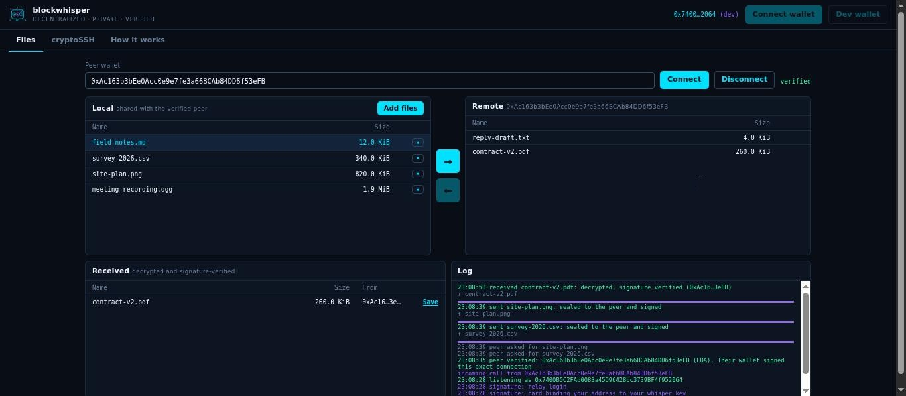
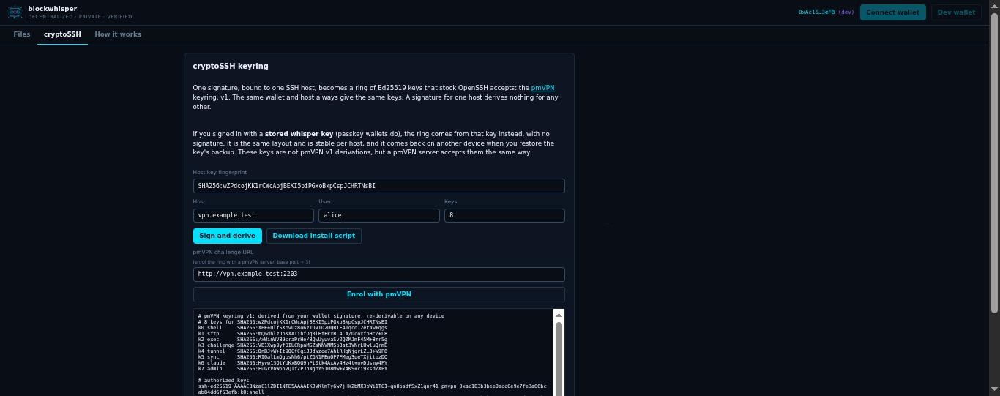
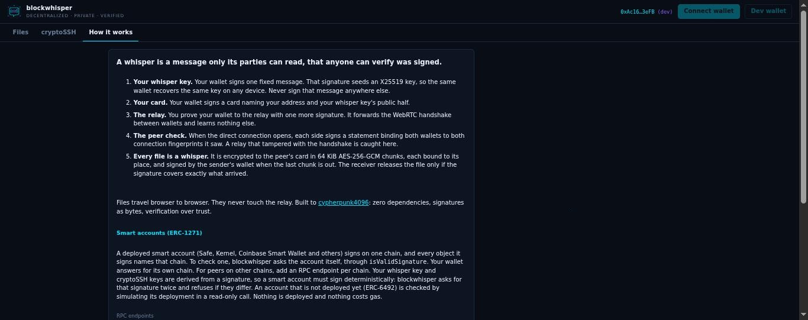
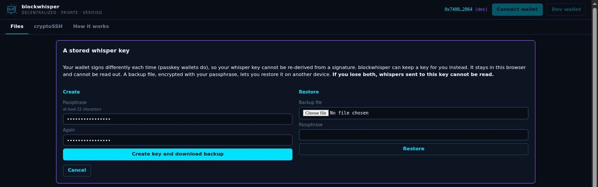

# blockwhisper, screen by screen

Screenshots of the blockwhisper dapp, published here from the private code repository
`blockwhisper/blockwhisper`, which stays private until release. Only the screens are public; the code is not.

These were captured on 2026-10-31 from the dapp running locally (`npm run serve`), with two browser tabs
signed in as two **dev wallets**. Dev wallets are throwaway keys held in the tab, so the addresses below
belong to no one. The files are random bytes with ordinary names. Every transfer shown really happened:
each file was sealed, sent browser to browser, decrypted, and released only after its signature
verified.

---

## 1. Files: the receiving side

The layout follows FireFTP: **Local** on the left, **Remote** on the right, arrows between them.

- **Peer wallet** holds the other party's address. **verified** (top right) means both wallets signed
  this exact connection (see §4). Nothing can be sent or listed before that.
- **Local** lists what this side shares with the verified peer. Files stay in the tab until they are
  sent. The highlighted row is selected for **→** (send).
- **Remote** is the peer's shared list, sent over the direct connection once both sides verified.
  Select a row and press **←** to fetch it.
- **Received** lists files that arrived, were decrypted, and whose sender's signature covered
  exactly the bytes that arrived. **Save** writes one to disk. A file that fails any check never
  appears here.
- **Log** shows each step. The violet bars are transfer progress. *peer verified … (EOA)* names the
  peer's signature scheme; a smart account would read *smart account, ERC-1271 on eip155:…*.

## 2. Files: the sending side

The same session from the other wallet. Its log, read from the bottom up, is the protocol in order:

1. `signature: card binding your address to your whisper key` and `signature: relay login`: signing
   in. With a derived whisper key, one more signature comes first.
2. `incoming call from 0x…`: the peer called through the relay. This side accepted it, inline in
   the log, with no browser dialog.
3. `peer verified … Their wallet signed this exact connection`: each side signed a statement binding
   both wallets to both WebRTC DTLS fingerprints. A relay that tampered with the handshake fails here.
4. `peer asked for survey-2026.csv` → `sent survey-2026.csv: sealed to the peer and signed`: the file
   was encrypted to the peer's card in 64 KiB chunks, streamed, then signed by this wallet.
5. `received contract-v2.pdf: decrypted, signature verified`: the peer pushed a file the other way.

## 3. cryptoSSH: a keyring for an SSH host

- **Host key fingerprint** is the server's OpenSSH `SHA256:` fingerprint (`ssh-keyscan host |
  ssh-keygen -lf -`). The wallet signs a message bound to it, so the signature derives nothing for any
  other host. This one is the public test fingerprint from pmVPN's vector.
- **Sign and derive** produces the ring. The header line says which kind it is:
  - *pmVPN keyring v1*: derived from the wallet's signature, byte-compatible with pmVPN, re-derivable on
    any device.
  - *stored-key keyring*: for a wallet signed in with a stored whisper key (§5). The button then reads
    *Derive from stored key* and no signature is asked for.
- The output lists the eight keys, one per pmVPN port (shell, sftp, exec, challenge, tunnel, sync,
  claude, admin), with their fingerprints, and then the `authorized_keys` lines.
- **Download install script** writes a shell script that installs the private keys (mode 600) and an
  `ssh_config` with one `Host` per port. **Enrol with pmVPN** registers the public keys with a pmVPN
  server, signed with a fresh challenge.

## 4. How it works

The in-app explanation of the five steps: whisper key, card, relay, peer check, and sealing every
file. Below them:

- **Smart accounts (ERC-1271).** A smart account names its chain in everything it signs, and is
  checked by asking the account itself. Your wallet answers for its own chain. **RPC endpoints**
  (further down) adds endpoints for peers on other chains. They are kept in this browser only.
  Accounts not yet deployed (ERC-6492) are checked by simulating their deployment in a read-only call.
- **Whisper key.** *Prefer a stored key* and *Forget the stored key kept in this browser* (below the
  fold).

## 5. A stored whisper key, for passkey wallets

A passkey wallet signs differently every time, so its whisper key cannot be re-derived. This panel
appears instead, when the wallet fails the "same signature twice" check, or when *Prefer a stored key*
is on.

- **Create** generates a random key and downloads a backup file before the key is used. The backup
  is encrypted with the passphrase (PBKDF2-SHA256 at 600,000 iterations, then AES-256-GCM, with the
  address and public key bound in). In the browser, the key is kept as a non-extractable WebCrypto key.
- **Restore** takes that backup file and passphrase on another device. It refuses a wrong passphrase
  or an altered file, and checks the key against its recorded public half.
- The bold line is the honest part: lose both the browser's copy and the backup, and whispers sent to
  this key cannot be read.

The same stored key also seeds the wallet's cryptoSSH keyrings (§3), so a passkey wallet can do
everything an ordinary wallet can.

